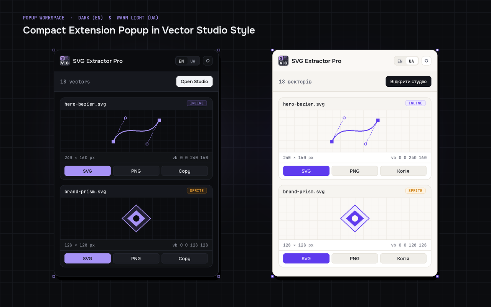
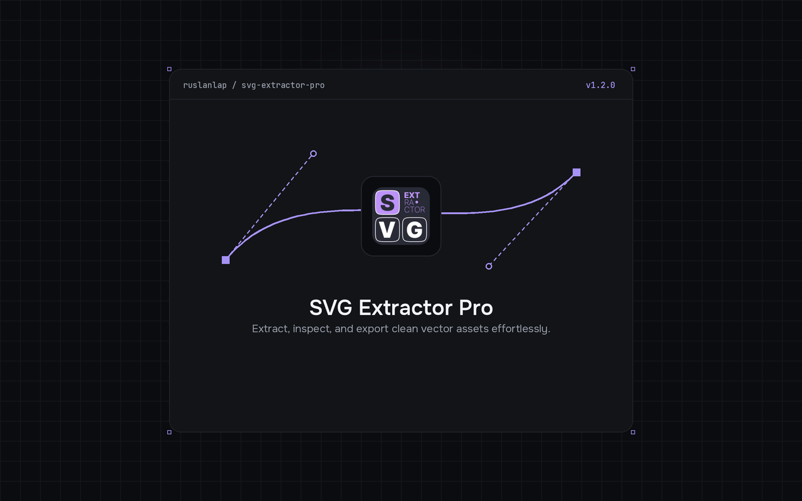
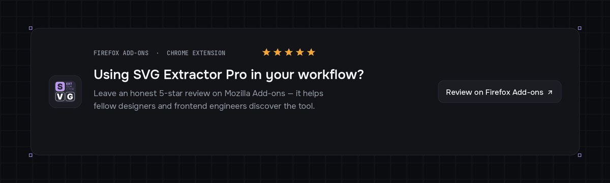

# SVG Extractor Pro

<p align="center">
  
</p>

<div align="center">
  

  <h3>Find, Inspect, and Export Clean SVG Assets from Any Web Page</h3>

  [](#)
  [](https://addons.mozilla.org/firefox/addon/svg-extractor-pro/)
  [](https://github.com/ruslanlap/SVG-Extractor-Firefox-and-Chrome-add-on/releases)
  [](LICENSE)

  
  
  
</div>

> **✨ Оновлення v1.2.0 — Vector Studio UI!** Повністю оновлений дизайн у стилі [ruslanlap Vector Studio](https://ruslanlap.github.io/ruslanlap_buymeacoffe/), підтримка `<use>` SVG-спрайтів та CSS-масок, миттєвий пошук і фільтрація, перемикач фону для контрасту, експорт PNG у `1×` / `2×` / `4×` та прискорене паралельне пакування у ZIP.

---

## 📸 Screenshots

| Dark Vector Studio (`EN`) | Warm Light Vector Studio & XML Inspector (`UA`) |
| :---: | :---: |
|  |  |

| Compact Extension Popup (`Dark` & `Light`) | Studio Cover Identity |
| :---: | :---: |
|  |  |

---

## 🚀 Features

- **Comprehensive SVG Detection**: Finds inline `<svg>` elements, resolves `<use>` sprite `<symbol>` references, `` & `<picture>` sources, `<object>`, `<embed>`, CSS `background-image`, and `mask-image` SVGs
- **Vector Studio Workspace**: Clean, precision UI in Dark (`#0B0C0F`) and Warm Light (`#FAF8F5`) themes with bundled offline `Onest` & `JetBrains Mono` typography
- **Instant Search, Filtering & Sorting**: Filter by `Inline`, `Sprite`, `Image`, or `Background`, search by name/viewBox/dimensions (`/` shortcut), and sort by page order, name, dimensions, or file size
- **Contrast Canvas Backdrops**: Switch preview backdrops between `Grid`, `Dark`, `Light`, and `Checker` so both white and dark icons stay sharp
- **Universal High-DPI PNG Export**: Export any SVG (inline, sprite, data URI, or image URL) as crisp `1×`, `2×`, or `4×` PNG
- **Interactive Source Inspector**: Inspect formatted XML source, copy SVG markup or Data URI in one click
- **Selective & Concurrent ZIP Export**: Select specific vectors or archive all with concurrent fetching and clean filename deduplication
- **Multilingual Support**: Seamless `EN` / `UA` switcher with persistent preferences across updates

---

## 📋 How It Works

1. **Install the Extension**:
   - **Firefox**: Install from [Firefox Add-ons store](https://addons.mozilla.org/firefox/addon/svg-extractor-pro/)
   - **Chrome / Edge / Brave / Opera**: Follow [CHROME_INSTALLATION.md](CHROME_INSTALLATION.md) (Manifest V3)
2. **Navigate to Any Website**: Open any page with icons, illustrations, or vector graphics
3. **Click the Extension Icon**: Scans the active tab without layout thrashing and opens/focuses the Vector Studio workspace
4. **Filter, Inspect & Preview**: Switch canvas contrast modes, inspect XML source, or toggle `EN` / `UA` and Dark / Light themes
5. **Export**: Download individual `.svg`, export `1×` / `2×` / `4×` `.png`, copy SVG / Data URI, or download selected/all as a `.zip`

---

## 💻 Chrome Installation (Manifest V3)

1. Download or clone this repository (or grab the Chrome `.zip` from [Releases](https://github.com/ruslanlap/SVG-Extractor-Firefox-and-Chrome-add-on/releases))
2. Open `chrome://extensions/` and enable **Developer mode**
3. Click **Load unpacked** and select the project root or `chrome-version/` folder
4. Pin **SVG Extractor Pro** to your toolbar

For full details, see [CHROME_INSTALLATION.md](CHROME_INSTALLATION.md) and [CHROME_WEB_STORE_SUBMISSION.md](CHROME_WEB_STORE_SUBMISSION.md).

---

## 🔧 Technical Details

- **Optimized DOM Scanning**: Skips non-visual tags and nested SVG primitives before calling `getComputedStyle`, reducing scan overhead on large pages
- **Sprite & Symbol Resolution**: Resolves in-page `<use href="#...">` targets and standalone `<symbol id="...">` spritesheets into self-contained valid SVG files with proper `xmlns` namespaces
- **CSS Mask & Background Extraction**: Parses multi-layer `background-image` and `mask-image` / `-webkit-mask-image` rules and resolves relative paths via `document.baseURI`
- **Privacy & Security**: 100% local processing, zero analytics/telemetry, zero external font/code requests (CSP compliant)

See [PRIVACY_POLICY.md](PRIVACY_POLICY.md) and [PERMISSIONS_JUSTIFICATION.md](PERMISSIONS_JUSTIFICATION.md) for details.

---

## 📥 Download & Reviews

<div align="center">
  <a href="https://addons.mozilla.org/en-US/firefox/addon/svg-extractor-pro/?utm_source=addons.mozilla.org&utm_medium=referral&utm_content=search">
    
  </a>
</div>

<br>

<div align="center">
  <a href="https://addons.mozilla.org/en-US/firefox/addon/svg-extractor-pro/reviews/">
    
  </a>
</div>

---

## 🛠️ Development

1. Clone the repository:
   ```bash
   git clone https://github.com/ruslanlap/SVG-Extractor-Firefox-and-Chrome-add-on.git
   ```
2. Install dependencies:
   ```bash
   npm install
   ```
3. Load in Firefox (`about:debugging` → **This Firefox** → **Load Temporary Add-on** → `manifest.json`) or Chrome (`chrome://extensions/` → **Load unpacked**).

---

## ☕ Support & Feedback

If **SVG Extractor Pro** saves time in your workflow, you can support its independent development:

<div align="center">
  <a href="https://ruslanlap.github.io/ruslanlap_buymeacoffe/">
    
  </a>
  <a href="https://forms.gle/xDCN4ACr5QKDmYkYA">
    
  </a>
  <a href="https://forms.gle/TYdupLT2yAHLWg4k7">
    
  </a>
</div>

---

## 📚 Documentation & License

- [Privacy Policy](PRIVACY_POLICY.md)
- [Permissions Justification](PERMISSIONS_JUSTIFICATION.md)
- [Chrome Installation Guide](CHROME_INSTALLATION.md)
- [Chrome Web Store Submission Guide](CHROME_WEB_STORE_SUBMISSION.md)

Licensed under the **MIT License**.
