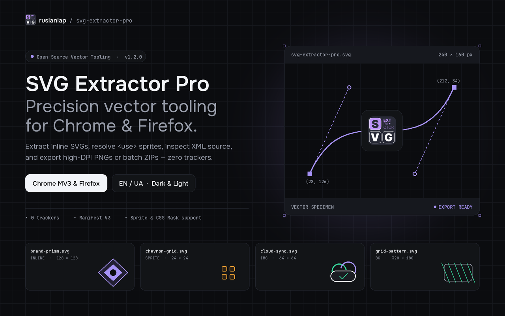
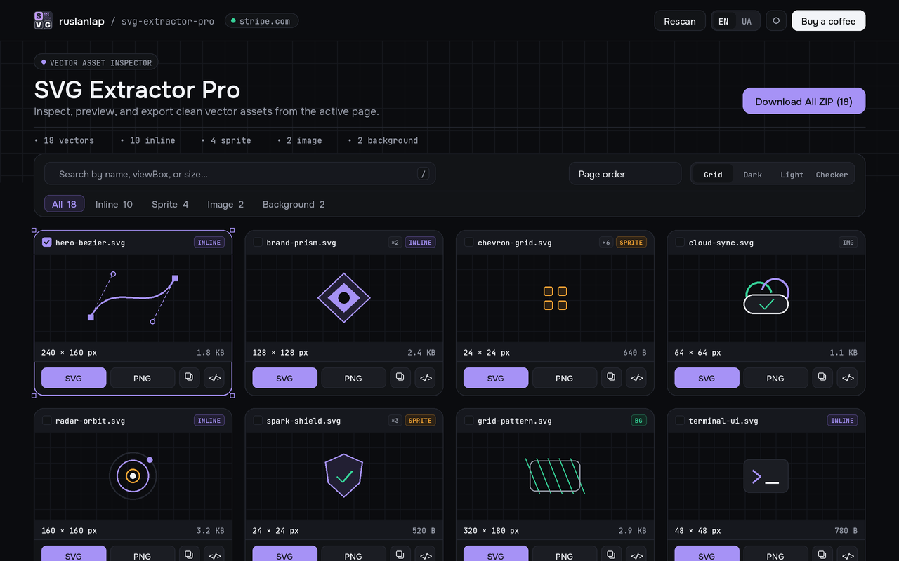
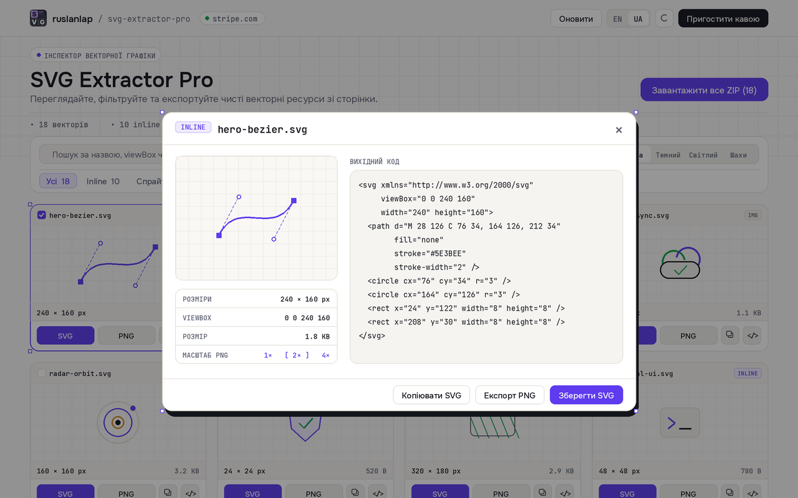

# SVG Extractor Pro



<div align="center">
  

  <h3>Find, Extract, and Download SVG Images from Any Web Page</h3>

  [](#)
  [](https://addons.mozilla.org/firefox/addon/svg-extractor-pro/)
  [](https://github.com/ruslanlap/SVG-Extractor-Firefox-add-on/releases)
  [](LICENSE)

  
  
  
</div>

> **✨ Оновлення v1.2.0 — Vector Studio UI!** Повністю оновлений дизайн у стилі *Quiet Precision Vector Studio*, підтримка `<use>` SVG-спрайтів та CSS-масок, миттєвий пошук і фільтрація, перемикач фону для контрасту, експорт PNG у 1×/2×/4× та прискорене паралельне пакування у ZIP.

## 🚀 Features

- **Comprehensive SVG Detection**: Finds inline `<svg>` elements, resolves `<use>` sprite `<symbol>` references, `` & `<picture>` sources, `<object>`, `<embed>`, CSS `background-image`, and `mask-image` SVGs
- **Vector Studio Workspace**: Clean, precision UI with Dark (`#0B0C0F`) and Warm Light (`#FAF8F5`) themes, `Onest` & `JetBrains Mono` typography, and zero external requests
- **Instant Search, Filtering & Sorting**: Filter by `Inline`, `Sprite`, `Image`, or `Background`, search by name/viewBox/dimensions (`/` shortcut), and sort by page order, name, dimensions, or file size
- **Contrast Canvas Backdrops**: Switch specimen preview backdrops between `Grid`, `Dark`, `Light`, and `Checker` for clear visibility of light or dark icons
- **High-DPI PNG Export**: Export any SVG (inline, sprite, or image URL) as crisp `1×`, `2×`, or `4×` PNG
- **Interactive Source Inspector**: View formatted XML source, copy SVG markup or Data URI with one click
- **Selective & Concurrent ZIP Export**: Select specific vectors or download all as a ZIP archive with concurrent fetching and clean filename deduplication
- **Multilingual Support**: Seamless `EN` / `UA` switcher with persistent preferences

## 📸 Screenshots

<div align="center">
  
  
</div>

## 📋 How It Works

1. **Install the Extension**:
   - **Chrome**: See [Chrome Web Store Submission Guide](CHROME_WEB_STORE_SUBMISSION.md) for publishing, or [CHROME_INSTALLATION.md](CHROME_INSTALLATION.md) for local installation
   - **Firefox**: Install from [Firefox Add-ons store](https://addons.mozilla.org/firefox/addon/svg-extractor-pro/)
2. **Navigate to Any Website**: Go to a website containing SVG images
3. **Click the Extension Icon**: The extension will scan the page for SVGs
4. **View Results**: Browse through all detected SVGs on the results page
5. **Download or Copy**: Save individual SVGs or download all as a ZIP file

## 💻 Chrome Installation

For Chrome users, this extension uses **Manifest V3**. To install:

### Option 1: Chrome Web Store (Recommended)
Coming soon! Follow the [submission guide](CHROME_WEB_STORE_SUBMISSION.md) to publish.

### Option 2: Developer Mode (For Testing)
1. Open Chrome and navigate to `chrome://extensions/`
2. Enable "Developer mode" in the top right
3. Click "Load unpacked" and select this folder
4. The extension is now ready to use!

For detailed instructions, see [CHROME_INSTALLATION.md](CHROME_INSTALLATION.md).

## 🔧 Technical Details

SVG Extractor Pro uses advanced detection techniques to find SVG images that other tools might miss:

- Detects inline `<svg>` elements
- Finds SVG files loaded via `` tags
- Discovers SVGs in `<object>` and `<embed>` elements
- Extracts SVGs used as CSS backgrounds
- Handles data URI SVGs

### Privacy & Security

- **Privacy-Focused**: All processing happens locally on your device
- **No Data Collection**: No personal information, browsing history, or analytics collected
- **No External Servers**: Your data never leaves your device
- **Open Source**: Fully transparent and auditable code
- **Manifest V3**: Latest security standards for Chrome extensions

For complete details, see our [Privacy Policy](PRIVACY_POLICY.md) and [Permissions Justification](PERMISSIONS_JUSTIFICATION.md).

## 📥 Download and Installation

<div align="center">
  <a href="https://addons.mozilla.org/en-US/firefox/addon/svg-extractor-pro/?utm_source=addons.mozilla.org&utm_medium=referral&utm_content=search">
    
  </a>
</div>

### Installation Steps:

1. Visit the [SVG Extractor Pro page on Firefox Add-ons](https://addons.mozilla.org/en-US/firefox/addon/svg-extractor-pro/?utm_source=addons.mozilla.org&utm_medium=referral&utm_content=search)
2. Click the "Add to Firefox" button
3. Follow the prompts to complete installation
4. The SVG Extractor Pro icon will appear in your browser toolbar

### Leave a Review

If you find SVG Extractor Pro helpful, please consider leaving a review on the Firefox Add-ons page. Your feedback helps others discover this tool!

<div align="center">
  <a href="https://addons.mozilla.org/en-US/firefox/addon/svg-extractor-pro/reviews/">
    
  </a>
</div>

## 🛠️ Development

### Prerequisites

- Firefox Browser
- Node.js and npm (for development)

### Installation for Development

1. Clone the repository:
   ```bash
   git clone https://github.com/ruslanlap/SVG-Extractor-Firefox-add-on.git
   ```

2. Install dependencies:
   ```bash
   npm install
   ```

3. Load the extension in Firefox:
   - Open Firefox
   - Navigate to `about:debugging`
   - Click "This Firefox"
   - Click "Load Temporary Add-on"
   - Select the `manifest.json` file from the project directory

## ☕ Support My Work

If you find SVG Extractor Pro useful in your projects or workflow, please consider supporting its continued development:

<div align="center">
  <a href="https://ruslanlap.github.io/ruslanlap_buymeacoffe/">
    
  </a>
</div>

Your support helps me:
- Maintain and improve SVG Extractor Pro
- Add new features and capabilities
- Create more useful tools and extensions
- Provide better documentation and support

Every contribution, no matter how small, is greatly appreciated and motivates me to continue developing free and open-source tools for the community.

## 📚 Documentation

- [Privacy Policy](PRIVACY_POLICY.md) - How we handle data and protect your privacy
- [Permissions Justification](PERMISSIONS_JUSTIFICATION.md) - Detailed explanation of why each permission is needed
- [Chrome Web Store Submission Guide](CHROME_WEB_STORE_SUBMISSION.md) - How to submit the extension to Chrome Web Store
- [Chrome Installation Guide](CHROME_INSTALLATION.md) - How to install in developer mode

## 🤝 Contributing

Contributions are welcome! Feel free to submit issues or pull requests.

## 📝 License

This project is licensed under the MIT License - see the LICENSE file for details.

## ☕ Support

If you find this add-on useful, consider [buying me a coffee](https://ruslanlap.github.io/ruslanlap_buymeacoffe/).

## 📬 Feedback

Have suggestions or found a bug? [Leave feedback](https://forms.gle/xDCN4ACr5QKDmYkYA) or [report a bug](https://forms.gle/xDCN4ACr5QKDmYkYA).